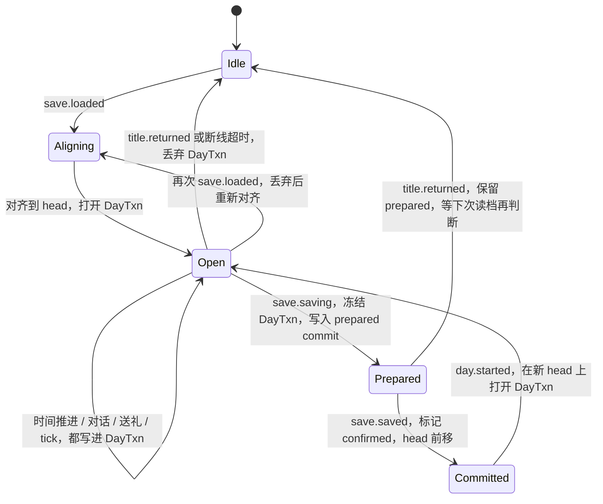
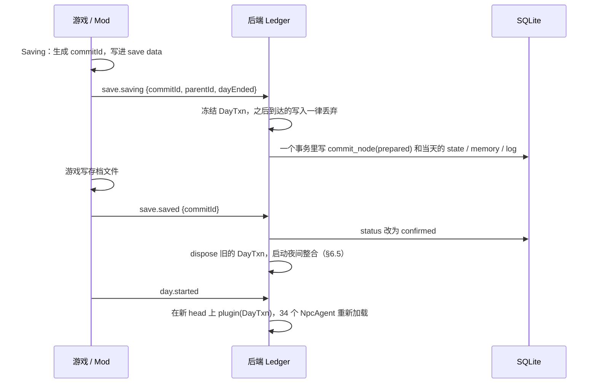

# 星露谷 NPC Agent 系统设计

> 状态：草案 v0.1（2026-10-18）。M1 已完成，M2 的对话部分已完成，M3a/M3b 已实现并在 Windows 上通过真机验收，34 张角色卡已写完。各里程碑的进度见 `docs/status.md`；M1 与设计的差异见 §16 和根目录 README。

## 0. 已确认的决策

| 问题 | 决定 |
|---|---|
| 交付顺序 | 先评审本文档，再写代码 |
| NPC 活跃方式 | 按定时 tick 自主行动，NPC 之间可以互动 |
| tick 频率 | 按距离分级：和玩家在同一张地图的 NPC 每游戏小时一次；其余每 3–4 游戏小时一次；同一地点的 NPC 合并成一次调用 |
| 回滚对齐 | 每个游戏日一个提交点，读档时回到存档对应的那个提交点 |
| 行为输出 | 对话加白名单动作，动作由 Mod 校验后执行 |
| 模型 | 云端便宜模型，走 OpenAI 兼容接口（DeepSeek、通义等） |
| 玩家输入 | 默认给出选项，同时保留“自己说”的自由输入 |
| 对话入口 | 保留原版点击对话；原版台词说完后，出现“继续聊”进入 Agent 对话 |
| 好感 | NPC 可以提高好感，也可以降低好感 |
| 联机 | 只支持单人，数据模型不预留“玩家”这一维 |
| 后端崩溃 | 支持恢复当天还没存档的内容（§6.7） |
| 角色卡 | 我来写，用 Markdown；核心部分约 500 token；台词照原版语气新写，不抄原文（§11） |

另外几条是默认假设，没有单独确认过，可以改：
- 对话用中文
- 存储用 Node 24 自带的 `node:sqlite`
- 覆盖 1.6 版本全部 34 位可以培养好感的 NPC

## 1. 需求在设计里的位置

| # | 需求 | 对应章节 |
|---|---|---|
| 1 | 每个 NPC 是独立 Agent | §4 NpcAgent 插件；§5.2 每个 NPC 的状态单独分区 |
| 2 | 所有 NPC 同时运行，开销低 | §7 分级 tick 和规则快路径；§9 共享模型网关、合并调用、前缀缓存 |
| 3 | 用 Cordis 做内核 | §4 |
| 4 | 每个“存档 × NPC”是一个跨天延续的 Session | §3 术语；§5 提交树 |
| 5 | 当天对话先不提交 | §6 当天事务 DayTxn |
| 6 | 没存档就回滚，由此产生的记忆和计划也一起回退 | §6；§6.5 派生数据的规则 |

## 2. 总体架构

```
┌───────────── Stardew Valley + SMAPI ─────────────┐
│ Bridge Mod（C#）                                  │
│  · 上报：读档、新的一天、时间、位置、对话、送礼、存档  │
│  · 执行：显示对话和选项，执行白名单动作              │
│  · 往存档里写 commit 指针（SMAPI save data）        │
└────────────────▲───────────────┬─────────────────┘
                 │ 本机 WebSocket，JSON 消息
┌────────────────┴───────────────▼─────────────────┐
│ Node 后端（Cordis）                                │
│  全局共享：store · model · roster · bridge · saves  │
│  每个已加载的存档一个隔离作用域：                     │
│    save ── world · ledger · scheduler              │
│      └─ day（当天事务，每天替换一次）                 │
│           └─ 34 × NpcAgent                         │
└──────────────────────────────────────────────────┘
```

游戏是事实来源。时间、天气、NPC 位置、原版好感、物品都以游戏为准。后端只保存 Agent 自己的东西：记忆、计划、情绪，以及 NPC 对别人的主观看法。

Agent 只能通过白名单动作影响游戏。动作造成的结果属于游戏存档，读档时由游戏自己回滚。

## 3. 术语

- **Lineage（存档谱系）**：一局游戏，ID 用 `Game1.uniqueIDForThisGame`。从这局复制出来的存档和 `_old` 备份都属于同一个 lineage。
- **Commit（提交点）**：某个游戏日结束、成功存档时，所有 NPC 的 Agent 状态变化。
  - 所有 commit 组成一棵树。正常往下玩是一条链。
  - 读回旧档继续玩，就会从旧节点长出一条新分支。
- **Head**：当前加载的存档所对应的 commit。
- **DayTxn（当天事务）**：从 head 出发，当天产生的所有未提交内容。
  - 包括对话、观察、新记忆、计划变化、NPC 之间的交流、动作记录。
  - 只存在内存里。
- **Session**：需求里说的“存档 × NPC”。
  - 实现上就是 (lineage, npc) 在当前分支上的状态：root 到 head 路径上这个 NPC 的全部已提交内容，加上 DayTxn 里属于这个 NPC 的部分。
  - 跨天延续靠 commit 链。
  - 不同 lineage 在存储里分开，运行时用 Cordis 的 `isolate` 隔开。
  - 不同 NPC 按 `npc_id` 分区。

## 4. Cordis 结构

### 4.1 插件树

```
root Context
├─ store      Service  全局  SQLite：提交树、记忆、状态、对话日志
├─ model      Service  全局  模型网关：队列、限流、预算、重试、prompt 布局
├─ roster     Service  全局  34 张角色卡（只读，可以热重载）
├─ bridge     Plugin   全局  WebSocket 服务，按 lineage 把消息转给对应的存档
└─ saves      Service  全局  SaveManager：读档时创建存档作用域，回标题时销毁
   └─ ctx.isolate('save').isolate('day')
      └─ SaveScope   Service 'save'  每个已加载的存档一个
         ├─ World      世界镜像（时间、天气、位置、原版好感）
         ├─ Ledger     读档对齐，prepare / confirm / discard
         ├─ Scheduler  分级 tick，按地点分组
         ├─ DayTxn     Service 'day'  当天事务，每天或回滚时替换
         └─ NpcAgent × 34  inject: save, day, model, roster, store
```

### 4.2 这样分的原因

- **共享和独立分开**
  - 模型、存储、角色卡整个进程只有一份，对应需求 2 的“底层服务共享”。
  - `save` 和 `day` 这两个与存档相关的服务，在 `isolate` 出来的上下文里提供。
  - 不同存档的 NpcAgent 看不到彼此的 `save` 和 `day`，所以从结构上就不会串档（需求 4）。
- **提交和回滚就是替换 `day` 服务**
  - NpcAgent 依赖 `day`。依赖的服务实例一变，Cordis 会先卸载依赖方，再用新实例重新加载它。
  - 回滚时，`dispose` 当天的 DayTxn fiber，顺序是：
    1. 所有 NpcAgent 先卸载。它们的定时器、事件监听、未完成的模型请求都挂在 effect 上，一起被清理。
    2. DayTxn 自己销毁。
    3. `dispose()` 返回的 promise 这时才 resolve。
  - 所以 `await dispose()` 本身就保证“当天所有活动都已经停下”。
  - 新的一天：在新 head 上执行 `plugin(DayTxn)`，NpcAgent 会自动重新加载。
  - NpcAgent 不保存任何跨天状态，跨天状态全在 store 里，所以每天重建 34 个 Agent 只是新建几个对象。
- **事件只发给本存档**：`ctx.emit(saveService, 'agent/tick', …)` 只会到达同一个存档作用域里的监听器，因为 Service 自带按 isolate 过滤的逻辑。
- **按调用方选择模型档位**
  - 后台 tick 写 `static inject = { model: { profile: 'background' } }`，对话模块写 `{ profile: 'dialogue' }`。
  - 网关内部用 `this[Service.resolveConfig]()` 读出当前调用方的档位。

上面四点都用探针脚本在 cordis@4.0.0-rc.11 上实际验证过。

### 4.3 代码骨架

```ts
import { Context, Service, type Fiber } from 'cordis'

declare module 'cordis' {
  interface Context {
    store: Store
    model: ModelGateway
    roster: Roster
    save: SaveScope
    day: DayTxn
  }
}

export class SaveScope extends Service {
  static inject = ['store', 'roster']
  openDay: (base: CommitRef) => void
  closeDay: () => Promise<void>

  constructor(ctx: Context, config: SaveScopeConfig) {
    super(ctx, 'save')
    let day: Fiber | undefined
    // 闭包里要用构造参数 ctx。服务方法里的 this.ctx 会被 Cordis 追踪成“调用方”的上下文，
    // 在那上面 plugin() 的话，DayTxn 会挂到调用方的 fiber 下，并且拿不到本存档的 isolate。
    this.openDay = (base) => { day = ctx.plugin(DayTxn, { base }) }
    this.closeDay = async () => { await day?.dispose(); day = undefined }
    for (const npcId of ctx.roster.ids()) ctx.plugin(NpcAgent, { npcId })
    ctx.plugin(Scheduler)
  }
}

export class DayTxn extends Service {
  readonly controller = new AbortController()

  constructor(ctx: Context, config: DayTxnConfig) {
    super(ctx, 'day')
    ctx.effect(() => () => this.controller.abort('day closed'))
  }
}

export class NpcAgent {
  static inject = {
    save: null, day: null, roster: null, store: null,
    model: { profile: 'background' },
  }

  constructor(ctx: Context, config: { npcId: string }) {
    ctx.on('agent/tick', (group) => { /* §7 */ })
    ctx.on('agent/talk', (turn) => { /* §7.6 */ })
  }
}
```

## 5. 状态与持久化

### 5.1 三层状态

| 层 | 内容 | 位置 | 生命周期 |
|---|---|---|---|
| 已提交 | 提交树，以及挂在上面的记忆、状态、对话日志 | SQLite | 永久保存，只追加 |
| 未提交 | DayTxn | 内存，另有一份崩溃恢复用的临时日志（§6.7） | 只到当天结束：存档时变成 commit，否则丢弃 |
| 临时 | 进行中的模型请求、调度队列、prompt 缓存 | 内存 | 随 fiber 一起释放 |

### 5.2 每个 NPC 的状态

| 部分 | 内容 | 多久变一次 | 怎么存 |
|---|---|---|---|
| 角色卡 | 身份、性格、说话风格、家庭和人际、喜好、原版设定、按心数解锁的话题、不能剧透的内容 | 不变 | `data/npcs/<id>.md`，不进 commit |
| 自我状态 | 情绪、最近的烦恼、长期目标、对自己近况的简述 | 每天 | `npc_state`，写时复制 |
| 主观关系 | 对玩家和其他 NPC 的看法、称呼、上次互动 | 每天 | 同上 |
| 计划 | 当天计划（时间段 → 意图、想聊的话题、想找的人）和待办（比如“答应玩家周五一起去海边”） | 每天 | 同上 |
| 情节记忆 | 一条条记忆，带重要度、主题、可见性 | 只追加 | `memory` 表 |
| 对话日志 | 原始对话和观察 | 只追加 | `log` 表，只用于整合和调试 |

原版好感（心数、约会、结婚）属于游戏状态，读档时由 Mod 发过来，后端只读。“主观关系”是另一回事，指 NPC 自己怎么看你。

记忆用下面几种方式控制增长：
- 夜间整合把当天日志压缩成少量情节记忆。
- 每 7 天和每一季再做一次分层摘要。
- 重要度低的旧记忆标记为“退场”：不再参与检索，但不删除，因为别的分支可能还要用。

检索在本地完成，按最近程度 × 重要度 × 主题或关键词匹配度打分。v1 不用向量检索，但留好接口，以后加嵌入检索不影响提交模型。

### 5.3 表结构（草案）

```sql
CREATE TABLE lineage (
  id         TEXT PRIMARY KEY,            -- Game1.uniqueIDForThisGame
  farmer     TEXT,
  farm       TEXT,
  created_at INTEGER NOT NULL
);

CREATE TABLE commit_node (
  id              TEXT PRIMARY KEY,       -- Mod 生成的 UUID
  lineage_id      TEXT NOT NULL REFERENCES lineage(id),
  parent_id       TEXT REFERENCES commit_node(id),  -- 创世节点为 NULL
  day_ended       INTEGER NOT NULL,       -- 结束的那个游戏日（绝对天数，从 1 开始）
  depth           INTEGER NOT NULL,
  status          TEXT NOT NULL CHECK (status IN ('prepared', 'confirmed')),
  consolidated_at INTEGER,                -- 夜间整合完成的时间，见 §6.5
  created_at      INTEGER NOT NULL
);

-- 体积小、会变化的部分，只在有变化时写。
-- phase = 'day' 是存档时写的；'consolidated' 是夜间整合追加的，读取时优先用它。
CREATE TABLE npc_state (
  commit_id TEXT NOT NULL,
  npc_id    TEXT NOT NULL,
  phase     TEXT NOT NULL CHECK (phase IN ('day', 'consolidated')),
  state     TEXT NOT NULL,                -- JSON
  PRIMARY KEY (commit_id, npc_id, phase)
);

CREATE TABLE memory (
  id         TEXT PRIMARY KEY,
  commit_id  TEXT NOT NULL,
  npc_id     TEXT NOT NULL,
  game_time  INTEGER NOT NULL,
  kind       TEXT NOT NULL,               -- conversation | observation | heard | reflection | summary
  text       TEXT NOT NULL,
  importance INTEGER NOT NULL,
  subjects   TEXT NOT NULL,               -- JSON 数组：涉及的人
  visibility TEXT NOT NULL,               -- private | normal，见 §7.5
  source     TEXT                         -- JSON：来自哪段对话或哪个场景
);

CREATE TABLE memory_retire (
  memory_id TEXT NOT NULL,
  commit_id TEXT NOT NULL,
  PRIMARY KEY (memory_id, commit_id)
);

CREATE TABLE log (
  commit_id TEXT NOT NULL,
  npc_id    TEXT NOT NULL,
  seq       INTEGER NOT NULL,
  game_time INTEGER NOT NULL,
  kind      TEXT NOT NULL,
  payload   TEXT NOT NULL,
  PRIMARY KEY (commit_id, npc_id, seq)
);
```

读取 head 处的状态分三步：
1. 用递归 CTE 取出 root 到 head 的路径，最多几百到上千个 id。读档时算一次，放进临时表。
2. `npc_state` 取路径上离 head 最近的那条。
3. `memory` 取 commit 在路径上、并且没有被路径上的 `memory_retire` 标记退场的那些。

不同分支共享同一段祖先数据，不需要复制。

体积估计：每个游戏日大约 0.1–0.2 MB，主要是原始日志。日志可以在整合后按季压缩或清理。

## 6. 提交与回滚

### 6.1 三个核心做法

1. **提交单位是“一个存档的一个游戏日”，覆盖全部 NPC。** NPC 之间白天说过的话要么一起留下，要么一起作废。比如 Abigail 把一件事告诉了 Sebastian，这天没存档，两个人都要忘掉。
2. **存档文件自己记住它对应哪个 commit。**
   - Mod 在 `Saving` 事件里用 SMAPI 的 save data 写入 `{ commitId, parentId, dayEnded }`，这些数据会随游戏一起写进存档文件。
   - 读档时 Mod 把它读出来交给后端。
   - 这样“读哪个档就回到哪个 commit”是精确的：恢复 `_old` 备份、复制存档、在旧档上开新分支都不会对错。
   - 只按游戏日期对齐不够，因为不同分支上可能各有一份“第 N 天”。
3. **Commit ID 由 Mod 生成。** `Saving` 时不用等后端回包，不会卡住游戏主线程。

### 6.2 一天的状态机



### 6.3 存档时序



### 6.4 读档对齐

Mod 发来 `save.loaded { lineageId, today, commit?: { commitId, parentId, dayEnded }, world }`，后端按下面的顺序处理：

1. **存档里有 commitId，store 里也有。**
   - 如果状态是 prepared，说明存档文件已经写成功，只是当时没收到 saved，改成 confirmed。
   - `dayEnded + 1 == today`：正常情况，head 就是它。
   - `dayEnded + 1 < today`：中间有几天没装 Mod 或后端没运行。head 仍然是它，但在 DayTxn 里放一条“间隔”标记，让 NPC 知道过了几天、这几天没有记忆。
2. **存档里有 commitId，但 store 里没有。** 说明存档时后端连不上。退到 `parentId`，再按第 1 条处理，此时间隔至少 1 天。
3. **存档里没有 commit 信息。**
   - lineage 已知：按游戏日对齐，取这个 lineage 里 `dayEnded < today` 的最近一次 confirmed commit，并记一条警告。只有这种情况需要猜，一般只在卸载 Mod 后又装回时出现。
   - lineage 未知：是新游戏或第一次装 Mod。创建创世 commit，用读档时的原版好感初始化每个 NPC 的主观关系。
4. 打开 DayTxn。

### 6.5 派生数据的规则

需求 6 要求“由没存档的对话产生的记忆和计划也要回退”。为此定一条规则：**派生数据的提交状态，不能比它的任何一个输入更“已提交”。**

- **白天产生的东西**
  - 从对话、观察里产生的新记忆、计划变更、关系变化，都写进 DayTxn，和对话一起保留或一起丢弃。
  - 当天之内 NPC 当然记得这些，因为读取时是“已提交状态 + DayTxn”叠加。
- **夜间整合**
  - 做三件事：把第 N 天的日志压成记忆、做反思、生成第 N+1 天的计划。
  - 只读第 N 天的 commit C 和它的祖先，结果作为 C 的附注写入：`memory.commit_id = C`、`npc_state` 的 consolidated 行、`consolidated_at`。
  - 整合只给 C 追加附注，不改写当天存档时写入的原始内容。
  - 它只依赖 C，所以对任何经过 C 的分支都成立。读档重玩第 N+1 天时直接复用，NPC 的早晨计划也保持一致，类似原版每天固定的随机种子。
- **整合不阻塞存档**
  - 整合是异步的。
  - 完成之前，第 N+1 天早上的 tick 和对话先用“临时上下文”：前一天的原始日志加上旧计划。
  - 早上 6–8 点大部分 NPC 还在家，调度器本来就很少安排调用，时间够用。

### 6.6 迟到的结果和各种中断

- 每个模型请求都带上 `day.signal`，DayTxn 被释放时请求会被取消。
- 就算请求已经返回，写入前也会检查 DayTxn 是否还开着、是否已冻结；迟到的结果直接丢弃。
- 每条消息都带 `loadNonce`，由 Mod 在每次读档时生成。上一次读档残留的消息不会写进新的一天。

| 场景 | 结果 |
|---|---|
| 聊了一天直接退出 | DayTxn 从来没被 prepare，直接丢弃；下次读档回到上一个 commit |
| `Saving` 之后、`Saved` 之前游戏崩溃 | 只留下 prepared 的 C'。如果存档文件写成功了，里面记的就是 C'，读档时转为 confirmed；否则存档里还是 C，C' 成为没人引用的分支，定期清理 |
| 恢复 `_old` 备份、复制存档、回到旧档重玩 | 存档里的 commitId 指向旧节点，从那里长出新分支。旧分支保留，其他存档文件照样能用 |
| 白天后端崩溃重启 | 用临时日志恢复当天的内容，见 §6.7 |
| 白天游戏崩溃 | 下次读档会生成新的 loadNonce，临时日志对不上，当天内容丢弃，和“没存档就忘”一致 |
| 存档时后端连不上 | Mod 照常存档；下次读档走 §6.4 第 2 条，丢掉那一天 |
| 晕倒、凌晨 2 点被迫睡觉 | 原版照常存档，流程不变 |
| 节日 | 节日期间游戏时间冻结，不 tick；节日本身作为世界事件记入观察 |
| 装了“随时存档”类 Mod | 同一天存多次会产生几个首尾相连的 commit，机制不变 |

### 6.7 后端崩溃后恢复当天内容

目标：游戏还开着，只是后端进程崩了或被重启，那么重连后 NPC 应该还记得今天到崩溃为止的内容。同时绝不能把内容恢复到另一次读档里。

- **临时日志**
  - DayTxn 的每一次写入，同时追加一行到 `.runtime/scratch/<lineageId>/<loadNonce>.jsonl`。
  - 第一行是文件头：lineageId、loadNonce、base commit、日期。
  - 追加是异步的，每秒或每 50 条刷一次盘。崩溃时最多丢最后一秒左右的写入。
- **Mod 端**
  - 后端断线期间，对话退回原版台词。
  - 事件按 `seq` 缓存（有上限，默认 2000 条），重连后补发。
- **重连与恢复**
  1. Mod 重连后发 `hello`，带上当前的 lineageId、loadNonce、head commitId、当前游戏时间和最后一个 `seq`。
  2. 后端找到同名临时日志，并且确认文件头里的 lineage、loadNonce、base commit 三项都一致，才回放日志，重建 DayTxn。
  3. 然后接收 Mod 补发的事件，按 `seq` 去重。
  4. 任何一项对不上，或者找不到日志，就按 §6.4 正常对齐，当天内容为空。
- **丢失的部分**：崩溃时还没返回的模型请求不重发，那一轮 tick 直接跳过；对话中的那一句提示玩家重说。
- **清理**
  - `save.saved` 之后删除这一天的临时日志，内容已经进了 SQLite。
  - 收到新的 `save.loaded`（loadNonce 变了）或 `title.returned` 时，删除旧的临时日志。
  - 后端启动时，清理超过 24 小时的残留日志。
  > 实现（2026-10-20）：前两条做了，第二条也覆盖后端中途重启过的情况，桥接层的检查点同样处理。第三条没做：按存档清理之后，残留只剩再也不读的存档各一份，几 KB；按时间删反而可能误删一个暂停了很久、还没退出的读档。
  > Windows 验收补充：新读档的提交/检查点必须先验证再丢弃旧工作区，已修复无效指针先删当天日志的问题。实际进程强杀后，同 nonce 恢复、失败读档后继续聊天、新 nonce 清理和跨存档保护均通过，见 `test-results/2026-10-20-new-parts-windows.md`。
- **只在白天恢复**：如果崩溃发生在 `save.saving` 之后，prepared commit 已经在 SQLite 里，恢复流程不需要临时日志，按 §6.4 处理。

## 7. Agent 运行时

### 7.1 时钟

tick 由游戏的 `TimeChanged` 事件驱动（每 10 游戏分钟一次），不看现实时间。暂停、打开菜单、过节时游戏时间不走，Agent 也就自动停下。

一个游戏日（早 6 点到次日凌晨 2 点）在现实中大约 14 分钟。

### 7.2 分级

| 级别 | 对象 | 频率 | 调用方式 |
|---|---|---|---|
| T0 对话中 | 正在和玩家对话的 NPC | 由事件触发 | 单独调用，优先级最高；对话期间这个 NPC 不参加别的 tick |
| T1 同一张地图 | 和玩家在同一张地图的 NPC | 每游戏小时 | 同一张地图的 NPC 合并成一次调用 |
| T2 其他地点 | 醒着、在别的地图 | 每 3–4 游戏小时（可配置） | 按地点分组，几个小组可以合并，每次最多 N 个 NPC（默认 6）；各组错开时间 |
| T3 休眠 | 在睡觉，或者当前不在世界里（比如第二年之前的 Kent） | 不 tick | — |

NPC 或玩家换地图时重新分级。

### 7.3 规则快路径

到点了也不一定调用模型。满足下面任意一条才调用：
- 地点里来了新的人（NPC 或玩家）。
- 有新事件：收到礼物、天气变了、有人对他说话、计划里这个时段写着要找某人或要做决定。
- 距离上次真正做决策太久：T1 超过 3 小时，T2 一天少于两次。

其他情况按早晨计划推进当前意图，不调用模型。预计能省掉一半左右的 tick，具体比例在 M2 用遥测数据校准。

### 7.4 合并调用的输入和输出

一次调用对应一个“场景”：某个地点的一组 NPC。

输入按“越稳定越靠前”的顺序排列，方便命中缓存（§9.2）：
1. 世界规则
2. 参与者的角色卡
3. 每个参与者的已提交摘要
4. 当前场景：时间、天气、地点、在场的人、各自当前意图、刚发生的事

输出是 JSON：

```json
{
  "npcs": {
    "abigail": {
      "intent": "想约 Sebastian 晚上打游戏",
      "say": [{ "to": "sebastian", "text": "今晚来我家？我新买了个卡带。" }],
      "memories": [{ "text": "Sebastian 答应晚上过来", "importance": 3, "subjects": ["sebastian"] }],
      "mood": "excited",
      "actions": [{ "type": "bubble", "text": "嘿！" }]
    },
    "sebastian": {}
  }
}
```

后端逐项校验：
- 丢掉不在场的 NPC、未知动作、超长文本。
- 每个 NPC 的新记忆只能引用他在这个场景里能看到或听到的内容，来源字段指向场景 ID。

### 7.5 NPC 之间的信息边界

合并调用会把几个 NPC 的上下文放进同一个 prompt，可能串信息，比如 A 的秘密从 B 嘴里说出来。对应的规则：
- 记忆有两种可见性。
  - `private`：只出现在这个 NPC 单独的调用里，比如和玩家对话的时候。
  - `normal`：可以进合并调用。合并调用只放 `normal` 的记忆。
- 玩家私下对某个 NPC 说的话，默认是 `private`。如果这个 NPC 自己决定转述，就以“A 告诉了 B”的形式进入 B 的记忆，并带上来源。
- NPC 之间的交流写进 DayTxn 里双方各自的分区，回滚时一起回滚。

### 7.6 和玩家对话

- **入口**：保留原版的点击对话，这样原版每天聊天 +20 好感和剧情台词都还在。原版台词说完后，出现一个“继续聊”的入口进入 Agent 对话。
- **每一轮**：玩家选一个选项，或者选“自己说”打字输入。
- **一次调用产出**：NPC 的回复、表情、下一轮的 3 个选项、动作，以及可选的“要记住的事”。选项和回复一起生成，所以走选项路径不会多出调用。
- **上下文**包括：
  - 角色卡和已提交摘要
  - 按玩家这句话检索出来的记忆，包括今天 DayTxn 里的
  - 今天和这个 NPC 的对话记录
  - 世界状态
  - 原版心数，以及是否在约会或已结婚
  - 心数解锁表：没到心数的话题不聊，也不剧透还没触发的心事件
- **延迟**：Mod 先显示“……”，回复流式显示。超时（默认 8 秒）就退回原版台词。

### 7.7 早晨计划和夜间整合

当前首版实现及 2026-10-20 的防记错修复见 [夜间整合](nightly-consolidation.md)：逐 NPC 调用，模型挑选对话编号，代码按原说话人生成记忆，印象所有心数都带，计划暂时只存。以下保留后续自主行动阶段的整体设想。

夜间整合（§6.5）为每个 NPC 生成三样东西：
- 由当天日志压缩出的记忆
- 对关系和自我状态的更新
- 第二天的计划：时间段 → 意图。会参考原版日程里他那时在哪，因为位置由游戏决定。

整合也合并调用，每次 4–6 个 NPC。当天没发生什么事的 NPC 不调用模型，只做规则更新。

> 实现（2026-10-20）：为了不让 NPC 之间串私密信息，记忆内核要求每次调用只给一个 NPC 的数据，所以没有合并调用；所有 NPC 共用同一段 system，靠前缀缓存省钱。计划先只写意图，不排时间段，也还没参考原版日程。见 `nightly-consolidation.md`。

## 8. 白名单动作

动作由后端提出，Mod 校验后执行，两边都检查上限。

| 动作 | 参数 | 默认限制（可配置） |
|---|---|---|
| `friendship.adjust` | delta，可正可负 | 每个 NPC 每天合计在 −40 到 +30 点之间（1 心 = 250 点；原版每天聊天 +20，送最爱的礼物 +80）。只有和玩家对话时（T0）才能发。具体数值在 M4 调整。第一版（2026-10-20）：对话每轮模型给 -2 到 2 的 `mood`，代码按熟悉程度换算（0–1 心每档 20 点，越熟越少，8 心以上或亲密关系 5 点）、按每天 −40 到 +30 截断，Mod 再核对一次，见 `npc-friendship.md` |
| `gift.give` | itemId | 只能从角色卡的可送物品表里选；每个 NPC 每天 1 次。第一版（2026-10-20）：6 心以上的 NPC 当天第一次开场时可能当面递一样，代码选、模型决定送不送，和寄信附赠共用 7 天冷却，见 `npc-in-person-gifts.md` |
| `mail.send` | 正文，可附带物品 | 每个 NPC 每天 1 封，按原版机制第二天送到。第一版（2026-10-20）：夜间整合写信，全部 NPC 一天最多 1 封；6 心以上时随信附一样角色卡里的东西，由代码选，普通品质、原价不超过 500 金、同一 NPC 7 天一次。见 `npc-mail.md` |
| `emote` | 原版表情 ID | 限制频率 |
| `bubble` | 不超过 40 字 | 头顶气泡，让玩家能旁听 NPC 之间说的话。第一版（2026-10-20）只显示夜间整合写好的自言自语，每句不超过 20 字，见 `npc-bubbles.md`；两个 NPC 站在一起、玩家在旁边时轮流冒 2–4 句闲聊，只显示不记忆，一天最多 4 段，见 `npc-chat.md` |
| `portrait` | 表情（开心、难过、生气、害羞等） | 只在对话中使用 |

- 每个动作有一个 `actionId`。Mod 执行后回复 `action.result`，结果是 done 或 rejected 并附原因。DayTxn 记录每个动作和它的结果。
- 白天没执行完的动作，存档时记为过期。
- 动作和记录不会对不上：
  - 动作改的是游戏状态（好感、物品、邮件），跟着游戏存档一起保存或回滚。
  - Agent 这边“我做了这个动作”的记录在 DayTxn 里，也一起保存或回滚。

## 9. 模型网关与成本

### 9.1 网关

- **一个服务给所有人用**：只有一个 `model` 服务，所有存档、所有 NPC 共用。
- **接口**：OpenAI 兼容的 `/chat/completions`，输出 JSON；对话走流式。
- **两个档位**：`dialogue` 和 `background`，可以配成不同的模型，比如对话用更强的那个。调用方通过 Cordis 的 inject 配置选择档位（§4.2）。
- **排队**
  - 优先级从高到低：T0 对话、T1、夜间整合、T2。
  - 有全局并发上限（默认 6）和每分钟请求数上限。
- **过期丢弃**：tick 请求带截止时间，即下一次同级 tick 的时间。排队太久，或者同一组已经有更新的请求，旧请求直接丢掉。
- **失败降级**：对话退回原版台词，tick 跳过，整合下次再试。
- **遥测**：每个游戏日的调用次数、token 数、缓存命中率，按档位和级别统计，可以从调试接口查看。

### 9.2 前缀缓存

DeepSeek 这类服务会自动缓存相同的前缀，命中的部分便宜很多。所以 prompt 一律按“越稳定越靠前”排：
1. 世界规则、输出格式、文风（所有调用都一样）
2. 角色卡（合并调用时按 NPC id 排序）
3. 已提交摘要（一天变一次）
4. 当前场景或对话（每次都不同）

### 9.3 调用量估计

以下按每个游戏日计，约等于现实 14 分钟：

| 来源 | 估计 |
|---|---|
| T1 | 20 轮 × 1 个地点，快路径省掉约一半，约 10 次 |
| T2 | 5–6 轮 × 5–6 组，扣掉快路径后约 15 次 |
| 夜间整合 | 34 个 NPC，每次 5 个，跳过没事的，约 5 次 |
| 对话 | 取决于玩家，约 10–40 次 |
| **合计** | **约 40–70 次** |

一次后台调用大约 3k 输入 token（大部分能命中缓存）加 0.5k 输出 token。具体费用按选定的模型价格算，M2 用遥测数据核实。

## 10. 和 Mod 之间的协议

使用本机 WebSocket，消息格式是 JSON。每条消息都带 `lineageId`、`loadNonce` 和 `seq`。

Mod → 后端：

| 消息 | 时机 | 主要字段 |
|---|---|---|
| `hello` | 连上时 | Mod 版本、协议版本 |
| `save.loaded` | `SaveLoaded` | today、commit、世界快照（所有 NPC 的位置、原版好感、是否已认识）、玩家信息 |
| `day.started` | `DayStarted` | today、天气、节日 |
| `time.changed` | `TimeChanged` | 时间，以及这次有变化的位置 |
| `talk.open` / `talk.say` / `talk.close` | 玩家对话 | npc，以及 optionId 或 text |
| `gift.given` | 送礼 | npc、物品、原版喜好等级。第一版（2026-10-20）：代码按模板给这位 NPC 记一条，不调用模型，见 `npc-gifts.md` |
| `action.result` | 动作执行后 | actionId、结果 |
| `save.saving` | `Saving` | commitId、parentId、dayEnded |
| `save.saved` | `Saved` | commitId |
| `title.returned` | `ReturnedToTitle` | — |

后端 → Mod：

| 消息 | 主要字段 |
|---|---|
| `talk.reply` | npc、文本（流式分片）、表情、options |
| `action.request` | actionId、npc、type、params |
| `status` | 后端状态、当天预算余量（给调试 HUD 用） |

断线时 Mod 先缓存消息，重连后按 `seq` 补发，后端按 `seq` 去重。后端崩溃后的重连流程见 §6.7。

## 11. NPC 名单与角色卡

1.6 版本共 34 位：
- **可以结婚**：Abigail、Alex、Elliott、Emily、Haley、Harvey、Leah、Maru、Penny、Sam、Sebastian、Shane
- **其他**：Caroline、Clint、Demetrius、Dwarf、Evelyn、George、Gus、Jas、Jodi、Kent、Krobus、Leo、Lewis、Linus、Marnie、Pam、Pierre、Robin、Sandy、Vincent、Willy、Wizard

角色卡由我来写，每位 NPC 一个 Markdown 文件：`data/npcs/<id>.md`，比如 `abigail.md`。
- 用 Markdown 而不是 JSON（包括酒馆的 chara_card_v2），是因为卡片大部分是中文长文本，手写 JSON 要处理转义和换行。原样放进 prompt 时，同样内容的 JSON 也比 Markdown 多 35%–77% 的 token。
- 文件名就是 NPC 的 id；一级标题是显示名；各部分用固定的二级标题分开。
- “人际关系”每行写“名字（id）：……”；不在 34 人名单里的人物（凯尔、齐先生、祝尼魔等）没有 id，括号省略，`roster` 解析时要允许。
- 模板在 `data/npcs/_template.md`，里面每一节都有填写说明。

模板包含这些部分：
- 身份与背景、性格
- 说话风格，以及口头禅示例
- 家庭和人际关系
- 喜好的文字描述（具体哪件物品喜不喜欢以游戏为准）
- 可送物品：写物品名就行，物品 ID 由 `roster` 根据游戏数据自动对应
- 按心数解锁的话题
- 不能说的内容（还没触发的心事件、剧透）
- 特殊条件（Dwarf 需要先学矮人语，Kent 第二年才出现，Leo 在姜岛等）

写卡用的参考资料在 `reference/`，说明见 `reference/README.md`：
- `reference/wiki/`：星露谷官方 wiki 的中英文 NPC 页面
- `reference/game/`：从本机游戏里只读导出的官方中文台词、日程和礼物喜好。这部分是游戏的版权内容，已加进 `.gitignore`，不进仓库

进 prompt 时由 `roster` 按需拼装，不是整张卡原样放进去：
- 身份与背景、性格、说话风格（含示例台词）、人际关系、喜好：每次都带。目标约 500 token；现有 34 张卡按 o200k 分词器实测是 530–690，平均约 620。
- 按心数解锁的话题：只带当前心数够得着的条目。
- 不能说的内容：只带还没看过的事件对应的条目；写着“任何时候”的条目一直带。
- 可送物品：只在需要选礼物时带。

示例台词照原版语气新写，不照抄游戏原文，所以 `data/npcs/` 可以进仓库。

角色卡是静态数据，修改它不需要动任何 commit；`roster` 服务支持热重载，加载时会检查必填的部分有没有写。

## 12. 目录与实现约束

```
src/
  index.ts              启动：创建 root Context，加载全局插件
  services/store/       SQLite（node:sqlite），提交树和路径查询
  services/model/       模型网关：OpenAI 兼容适配器、队列、预算、prompt 布局
  services/roster/      角色卡的加载和校验
  save/manager.ts       SaveManager，按 lineage 创建隔离的作用域
  save/scope.ts         SaveScope（'save'）
  save/ledger.ts        读档对齐、prepare / confirm / discard、整合任务
  save/day.ts           DayTxn（'day'）
  save/world.ts         世界镜像
  agent/npc.ts          NpcAgent
  agent/scheduler.ts    分级 tick、分组、快路径
  agent/scene.ts        合并场景调用和输出校验
  agent/dialogue.ts     和玩家对话
  agent/memory.ts       检索、整合、分层摘要
  agent/actions.ts      白名单和上限
  bridge/protocol.ts    消息类型
  bridge/server.ts      WebSocket 服务
  demo.ts               离线 demo：模拟游戏事件，用假模型
data/npcs/*.md          34 张角色卡
reference/              写卡用的参考资料（wiki 页面、游戏导出数据）
tools/reference/        重新生成 reference/ 的脚本
tests/*.test.ts
mod/                    SMAPI Mod（C#），M3 再做
```

实现约束：
- Node 24 直接运行 `.ts`（靠类型剥离），而 `tsconfig` 开了 `erasableSyntaxOnly`。所以代码里不能用 enum、构造函数参数属性，也不能用带运行时代码的 namespace。
- Node 只自带 WebSocket 客户端，服务端需要 `ws` 包。除了 Cordis，这是唯一计划新增的运行时依赖。

## 13. 测试重点

测试全部用确定性的假模型，不联网。

1. **回滚不变量**：不管中间做过什么操作，读档到 C 时，每个 NPC 的状态都和 prepare C 那一刻一样。
2. **存档隔离**：两个 lineage 同时加载，彼此看不到对方。
3. **跨 NPC 原子性**：白天 A 告诉了 B 一件事，不存档就读档，A 和 B 都不记得。
4. **迟到结果**：回滚之后才返回的模型请求，不写进任何地方。
5. **崩溃窗口**：只有 prepared、没有 saved 的情况，分别模拟存档文件写成功和没写成功。
6. **分支**：回到 `_old` 重玩之后，新旧两个分支各自读档都正确。
7. **派生一致**：整合结果只依赖 commit；同一个 commit 读档多次，早晨计划都一样。
8. **调度**：分级正确、快路径生效、预算用完时能降级。
9. **崩溃恢复**：白天杀掉后端再用同一个 loadNonce 重连，NPC 还记得崩溃前的内容；换一个 loadNonce 重连，当天内容为空。

## 14. 里程碑

当前进度见 `docs/status.md` §2。

- **M1 存储与事务**
  - 实现 store、ledger、DayTxn、SaveScope、临时日志，加上假模型和离线 demo。
  - §13 的第 1–7 条和第 9 条测试全部通过。
- **M2 Agent**
  - 实现 NpcAgent、调度器、场景调用、对话、整合。
  - 模型网关接上真实模型，用遥测数据校准调用量。
- **M3 接入游戏**
  - 实现 bridge 协议和 SMAPI Mod。
  - 在游戏里跑通完整流程：读档 → 对话 → 存档 / 不存档。
- **M4 内容**
  - 我写好 34 张角色卡，你审阅；我负责加载校验、物品名到 ID 的对应、心数解锁表的接入。
  - 调整各个动作的上限。

## 15. 待确认

暂无。

## 16. M1 实现说明（2026-10-18）

当前分支实现独立 NPC 会话句柄、单数据库 Worker、SQLite 提交树与状态、FTS5 中文检索、DayTxn、prepare/confirm、旧档分支、JSONL 恢复和确定性离线示例。完整自主 Agent 循环、真实模型、WebSocket 与 SMAPI 尚未实现。

与最初草案相比，本次根据后续讨论作了这些选择：

- 新增 `@node-rs/jieba` 作为中文分词依赖；分词、FTS5 查询和记忆排序共用同一 DB Worker，主线程不加载词典。
- 当天 JSONL 每次追加后 `sync` 才确认接收，不采用原先每秒刷盘的策略。写入仍由异步文件 API 完成。
- 默认 8 条、4000 Unicode 字符的检索预算；它不是精确 token 预算。共享场景只返回普通可见记忆，不返回自由 JSON 状态和原始私密记录。
- 严格依赖传入的提交指针。缺少指针从创世开始；显式引用不存在的提交时报错，不按日期猜分支。
- `state` 是整对象快照；记忆追加，退场标记随分支版本化。
- `consolidateCommit` 提供来源提交受限、幂等的整合接口，私密输入逐 NPC 隔离；当前示例使用假模型，尚不自动运行夜间或周/季整合。
- 过期 nonce 的临时日志不恢复。2026-10-20 补上清理：同一存档用新的 nonce 读档成功后删除其他 nonce 的临时日志（见 §6 “清理”）。

使用方式、实际限制和源码路径见 `README.md`；学习顺序见 `docs/learning-memory.md`。
